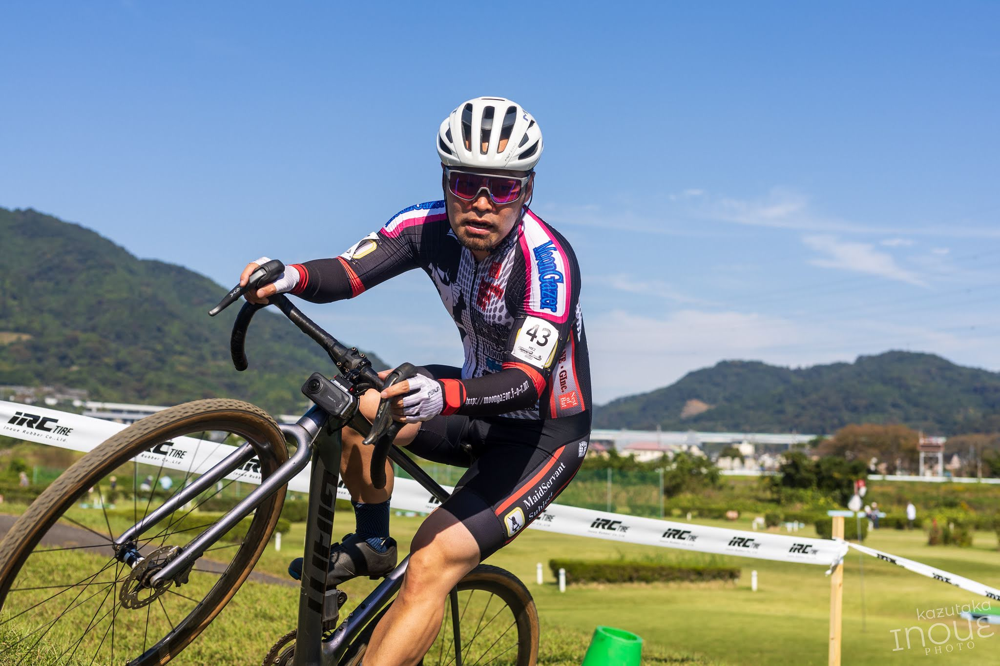

## リザルト

10/35位 (+1:45, 28%)

### 機材

- メインバイク
  - GIANT TCX ADVANCED PRO
  - Farsports CX TU + A.Dugast Typhoon 33c (F: 1.60 Bar, R: 1.60 Bar)

※空気圧は[CYCPLUS AS2 PRO](https://amzn.to/3XXh90k)による空気圧設定

<Amzn asin="B0CNPDJQYT" />

駆動系の潤滑にはチェパークのチェーンワックスを利用。レース後に、フレームと一緒にチェーン周りを**マックオフナノテククリーナーで洗えば、駆動系も含めて綺麗に洗車が終わる**ので、時短になり助かっている。

<Amzn asin="B0C4NVS7TB" />

今シーズンから、撮影機材は[Insta360 X6](https://link.amazon/B01LM0YCA)を横向きにマウントしてフロントレンズだけの撮影モードを使用。

<Amzn asin="B0H5CR9LZF" />

## コース

湘南シクロクロスのシーズンインを告げる、河川敷公園の芝生とキャンバーエリアを使った定番コース。

最も気持ちよく曲がれない（苦言）ことで定評のあるコースだったが、今年は逆バンクと厭らしい杭の配置が鳴りを潜め、スキル次第でグリグリとブレーキ少なめで曲がっていける設営となっていた。個人的にはレーサー間のスキル差が大きく反映されるので好みの設定だ。

実は管理塔に100円で使えるシャワールームがあるのも密かなポイント。一部屋だけだが、銭湯に行くより時短になるし、砂埃にまみれた体をリフレッシュして帰宅できるのは良い。

## 高強度トレーニングブランクからのレース

別途記事にするが、今年は第2子が産まれたこともあって、ほぼレース用のトレーニングをしていない状態でのシーズンインとなった。

スキマ時間を使ったZ2ライドと、レース直前のスキル練習でコーナリングの勘を取り戻しただけの最低限の準備。Z2トレーニングにより推定VO2MaxやFTPは向上したものの、高強度の練習は皆無だったため「ライドはできてもレースができない状態だったらどうしよう」「降格したらグラベルロードでレースに出ようかな…」といったネガティブな考えが珍しく頭をよぎった。

オーバーテイク時にハイパワーでガツンとアタック、ということは絶対にできない（すぐに代償を払うことになる）ことは目に見えていたので、強引にポジションを上げることだけはするまいと心に決めてスタートラインへ。

### レース展開

<iframe width="560" height="315" src="https://www.youtube.com/embed/pTSrtnp6HHI?si=ul6-4DuK9KlnpoHj" title="YouTube video player" frameborder="0" allow="accelerometer; autoplay; clipboard-write; encrypted-media; gyroscope; picture-in-picture; web-share" referrerpolicy="strict-origin-when-cross-origin" allowfullscreen></iframe>

最高気温27度の中、13時10分という秋の気温ピーク時間帯にME2はスタート。事前に濡らしたウェアは既に太陽で乾いている。

後方からのスタートかつ、残った内側グリッドを選ばざるを得なかったので序盤は隙間を縫って立ち回る。ライダーは詰まっているので、フィジカル的には余裕がある。長めのストレート前のコーナーでは勢いをつけて立ち上がり、速度差を作って前へ上がっていく。

ヨピノリさんのラインを学んだり、脚のある人にストレートを引っ張ってもらいながら3周目に入ったところで暑さの厳しさを感じてペースを下げた…はずなのだが、周りもスローダウンしている。

ペースを下げると、思ったよりも心拍数が落ち着いている（サイコンを見ていないので感覚だが）。誰かの後ろに下がった時の脚の回復も速く、Z2トレーニングで回復力が上がったと判断して、要所ではFTP〜VO2Max域で踏み、タイムに影響しづらい場所で休む戦略に切り替え。爆発的な順位アップこそ無いものの、ほぼ最後尾から10位まで上げてのフィニッシュとなった。

## 振り返り

当初の不安はどこへやら、シクロクロスの曲げて踏む楽しさを思い出し、久しぶりに自転車を外で思い切り楽しめた。家を空けている間に子供二人を見てくれた妻には大感謝。

意外なトレーニング成果も確かめられ、有意義なレースになった。

## Photo

Photo by [Kazutaka Inoue](https://x.com/InoueAccount)
