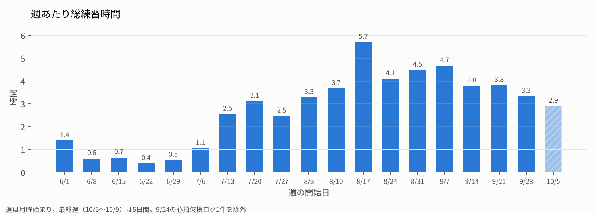
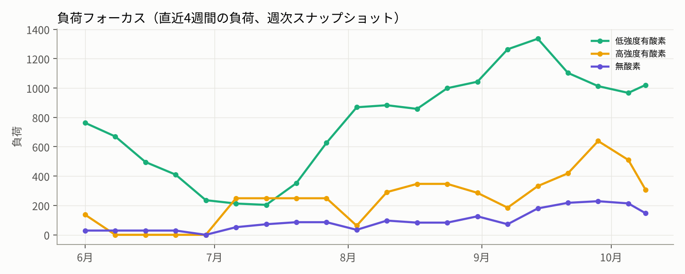
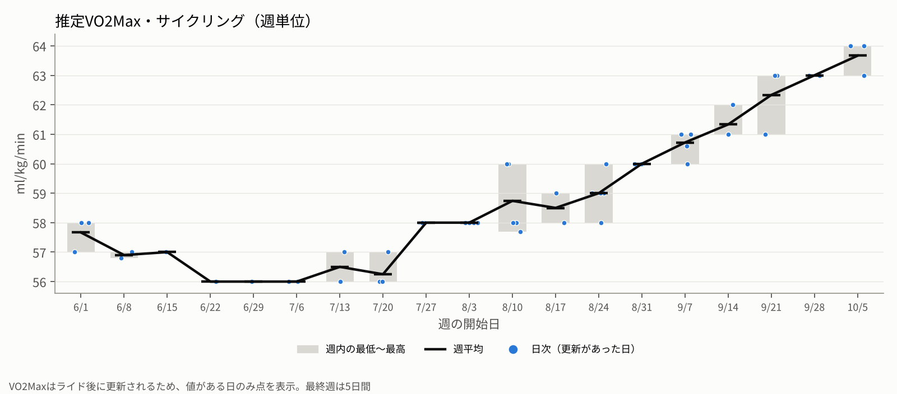
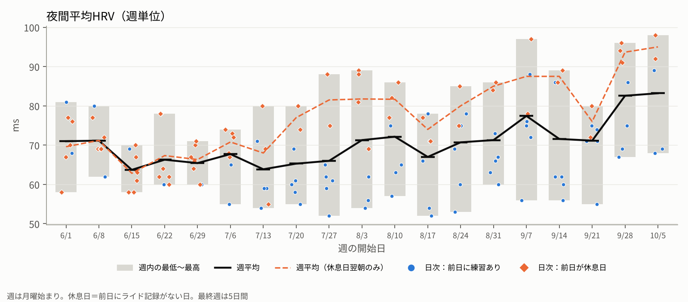
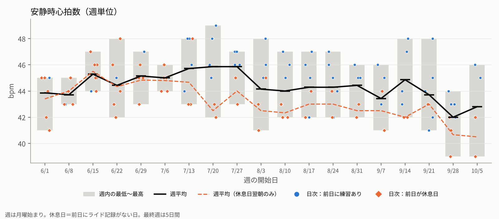

第二子が産まれて、生活における自転車の優先順位が更に下がったが、パフォーマンス劣化は可能な限り避けたいという気持ちは変わらず。

子供が早起き！昼間は子育て（と仕事）！という生活で、習慣化できるタイミングは夜しかない。シクロクロスのことを考えると、本来はCXと同じ運動特性である高強度トレーニングをやるべき…

しかし、朝型人間ということもあって、夜に高強度トレーニングをすると睡眠（と翌日）に大きく響くことは、過去のトレーニングと誕生直後のお試し期間で分かっている

しかも、高強度トレーニングに必要な回復期間を考えると、練習頻度は少なくせざるを得ず、トータル負荷はそこまで稼げない。

睡眠や翌日の活動に影響を与えない**習慣化できる持続可能なトレーニング**で、かつ**総ボリュームを最大化する**には、必然的に低強度を沢山積むしかないと考えた。[これまで行ってきたシクロクロス向けトレーニング](https://blog.gensobunya.net/post/2021/12/cx_training_2021/)と相反するとはいえ、やれない高強度練に未練を持っても仕方がない。

かくして、CXシーズンに低強度トレーニングだけで突撃する人体実験が始まった。

期間は7月中旬から10月頭までの約3カ月。

指標は興味ないけど結果だけ知りたいという方は、[先週の湘南CX記事](https://blog.gensobunya.net/post/2026/10/26-27_kaisei/)へGo.

## トレーニングの内容

基本的なテーマとルールは以下の3項目とした。

- 強度より頻度
- サドルに座ったら偉い
- 2日連続で休まない

いわゆるZ2（Zwiftの青ゾーン）を基本にしてそれより出力と心拍を上げないこと、と低強度の目安と定義して自らに課した。

10分でも15分でも、Zwiftを起動してロボペーサーとダラっと走ることを正当化し、習慣化のためのルールだ。

## 結果

### レースリザルトと体感

レース中の体感はレースレポートに書いているが、なんと昨年の漫然と高強度トレーニングをしていた時期の順位%(35%)よりも上位(28%)でゴールできた。

<LinkCard url="https://blog.gensobunya.net/post/2026/10/26-27_kaisei/" />

特に、**ドラフティング中や踏めない区間での、心肺の余力回復スピード**が印象的だった。これまでのCXと同じ強度を目指すトレーニングが『限界近くの出力を長く出せるようにする』効果を生んでいたのに対し、『そもそも余裕を持って出せる出力が高くなる＝それなりのパワーでも回復できる』ベーストレーニングの効果が如実に出ていた。

正直、今回のレースを走るまではシクロクロスにベーストレーニングがそこまで重要なのか懐疑的だったが、認識を改める良い機会となった。

ただ、あくまでN=1の体感に過ぎない。また、自分はもともと瞬発系の運動は得意で、体格も（良く言えば）ガッチリ系の特性を持っているということも考慮すると、今回のプログラムが不足能力を補う形となった可能性が高い。他者での再現性は不明だ。

シクロクロスのスキル練習は1回のみという極端さなので、**過去のCX経験やスキル貯金がない人には全くおすすめできない**という点は特に強調しておきたい。

### 指標

期間中は、週あたり平均して4.6日、週あたり時間は3.8時間のペースでバーチャルライド。

ここからのグラフは、比較用にZwiftのWeekly Streak維持目標で走っていた6/1〜7/12を含めているが、**7/13〜10/9が実際のZ2トレーニングルールを適用した期間**となっている。

指標改善（7/20週 → 10/5週）は下記の通り。

- FTP 242W(昨年ベスト) → 251W(9/23)
- 推定VO2Max **56.2 ml/kg/min** → **63.7 ml/kg/min**
- 休息日安静時心拍数 **42.5 bpm** → **40.5 bpm**
- 休息日夜間HRV **77 ms** → **95 ms**

### トレーニング経過の所感

**あくまで体感値**だが、150bpm程度で数分持続して出せるパワーが180Wほどから220Wまで上がっており、Watt/HR比が大幅改善した。GARMINの[推定VO2Maxは心拍とパワーから算出される](https://www.garmin.com/ja-JP/blog/running/vo2max/)ため、Watt/HR比の改善がそのまま推定値の上昇に表れたと考えられる。

最大心拍7割以下でダラッと走る時のペーサーがD→Cに上がったといえば、Zwiftユーザーにはわかりやすいか。

ライド後の"疲労感"については、秋頃に大きな変化が出た。1時間のZ2ライドを行っても、補給をすれば翌朝にほとんど疲労を感じなくなった。なまじ余裕があるせいで、後半はうっかりイベントで踏みすぎたりZwiftレースに浮気したりした日も多い。

日常でも調子がいいので、医学的に『適切な運動』とはこれぐらいなのだろうと思っていたところ、実際にWHOの身体活動ガイドラインを読むと、『中強度で週150〜300分』とされており、週約3.8時間のこのトレーニング期間はまさにそのレンジに入っていた。

## おまけ：モチベの保ち方

最初はアニメや映画を見ながら乗っていたが、暇つぶしコンテンツ(アニメ・映画・[白妙とき](https://www.youtube.com/@rag_toki)Zwiftライブ)がすぐに尽きてしまう。ネタ切れが始まった頃からは、ZwiftのRoute/Climb of the week消化をして経験値を稼いだり、イベントのLate Joinを使ってルート実績を稼いだり、バイクアップグレードを狙いながら走ったりしてプチ目標を消化していた。

今はトロンバイクのアップグレード条件（Zwiftバイク3台のLv.5化）も満たし、数千kmに及ぶLv.5トロンの育成中。Zwiftはコミュニティ力も高いしエンドコンテンツもあるし、目標探しには事欠かないのが良い。

### おすすめ定期イベント

- BMTR Adventure: 20-40kmのコースを週に数日イベント化してくれるので、Late Joinからのコースバッジ稼ぎに最適
- ZwiftInsider Thursday Pizza Burner: 木曜のみ、BTMR Adventureと同じようなコース選択でEXP2倍ボーナスが貰える。参加者が多いのでゆるく走ってもドラフティングで距離を稼げる
